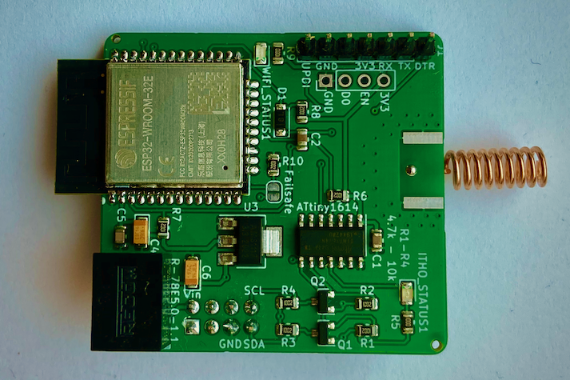
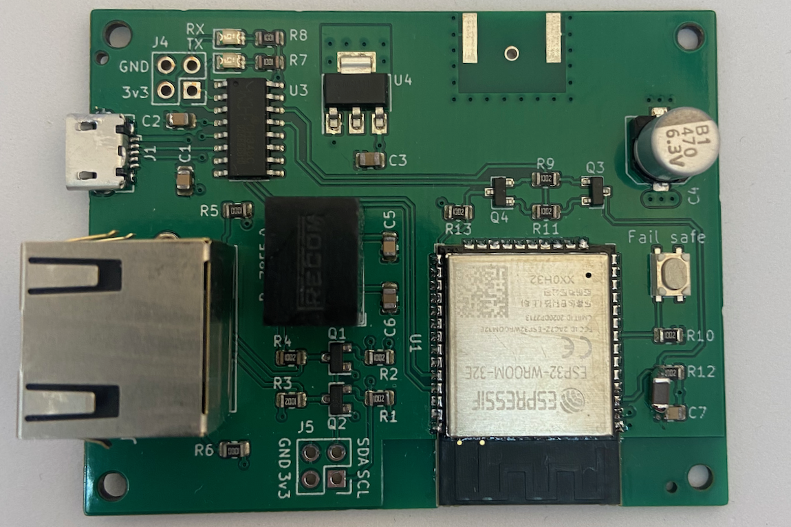

# ithowifi
ESP based WiFi controller for Itho devices

*(note: I'm in no way a professional hardware/software engineer and have no background in these subjects. I like this for a hobby, to learn and to share my projects)*

Finished boards can be ordered in my webshop:
[https://www.nrgwatch.nl](http://www.nrgwatch.nl)
or in my Tindie store:
[https://www.tindie.com/products/19680/](https://www.tindie.com/products/19680/)

|CVE Add-on|non-CVE wifi module|
|:---:|:---:|
|  |  |

## WiFi add-on to control itho central ventilation units

-   Control your Itho Daalderop ventilation unit with one simple add-on module
-   No hardware changes needed to the Itho unit, no warranty void
-   Control fan speed through the web interface, REST API v2, MQTT, or Home Assistant
-   Send remote commands via virtual remotes (I2C) or RF remotes (CC1101 wireless)
-   RF standalone mode for devices without I2C connection (e.g. HRU 400 R)
-   OTA firmware updates directly from the web interface
-   Easily integrate in any home automation system through MQTT or REST API
-   Companion integrations available:
    - [Home Assistant](https://github.com/arjenhiemstra/ithowifi-ha-integration) (REST API, elementary)
    - [Home Assistant](https://github.com/jasperslits/haithowifi) (MQTT API, feature rich)
    - [Homey](https://homey.app/en-nl/app/nl.monkeysoft.nrgwatch/Itho-Daalderop/) (REST API)
-   Installation can be done in minutes
-   Detailed installation manual and setup wizard

### CVE models (IthiWiFi CVE add-on - I2C):
-   CVE ECO 2 (also sold by 'Heatrae Sadia' in the UK)
-   CVE ECO RFT (SE/SP, HE/HP)
-   CVE-S ECO / PAK / Optima / CO2
-   HRU ECO 150E / 150P
-   HRU ECO 200E / 200P (also sold as 'Elektrodesign EHR 140 Akor BP' and 'Heatrae Sadia Advance Plus')

### NON-CVE models (IthiWiFi NON-CVE add-on - I2C):
-   HRU ECO 350 LR / LP / HR / HP
-   HRU ECO LE / HE / LP / HP BAL
-   HRU 3 (3) and HRU 3 (2)
-   HRU ECO 250R / 250P, HRU ECO 300R / 300P and HRU ECO 300 DUO Zone (with adapter board, PCI-e splitter cable and CC1101)
-   DemandFlow / QualityFlow
-   WPU 4G / 5G (heat pump)
-   AutoTemp

### RF standalone mode (IthiWiFi NON-CVE add-on wuth CC1101):
-   HRU 300V, HRU 375V and HRU 400 R
-   Most Itho devices controllable via RF (CC1101 module required)
-   Status data received wirelessly via 31DA/31D9 RF messages

### HRU models by article number:
Check the article number on the nameplate/sticker of your Itho. x is any digit. A letter after the number (A, S) does not count.

| Model | Article number | Add-on |
|---|---|---|
| HRU ECO 150E / 150P | 03-0001x | CVE add-on |
| HRU ECO 200E / 200P | 03-0040x | CVE add-on |
| HRU ECO 250R / 250P | 03-0021x | non-CVE set (with adapter and RF module) |
| HRU ECO 300R / 300P | 03-0030x, 03-00500, 03-00501 | non-CVE set (with adapter and RF module) |
| HRU ECO 300 DUO Zone | 03-00502 | non-CVE set (with adapter and RF module) |
| HRU ECO 350 LR / LP / HR / HP | 03-00389, 03-0039x | non-CVE add-on |
| HRU 300V | 03-00851 | non-CVE add-on + RF module |
| HRU 375V | 03-00853 | non-CVE add-on + RF module |
| HRU 400 R | 03-00584 | non-CVE add-on + RF module |
| HRU ECO LE / HE / LP / HP BAL | 545-426x, 545-427x | non-CVE add-on |
| HRU 3 (3) | 545-421x to 545-425x | non-CVE add-on |
| HRU 3 (2) | 545-41xx, 542-0005 | non-CVE add-on |
| HRU 3 (1) | 545-40xx | Not supported |
| HRU 2 | 540-7003 to 540-7009, 540-7010, 540-702x | Not supported |
| HRU 1 | 540-7001, 540-7002 | Not supported |

####   Note about CVE and HRU ECO 200 firmware:
The CVE add-on controls the Itho unit in standard or medium mode setting only. If you leave the Itho in low or high setting, it won't accept I2C commands from the add-on (Itho designed behaviour). Adding a CC1101 RF module and/or using the virtual remote function can circumvent this issue. The virtual remote function can also be used to force medium mode before sending commands.

## APIs

The add-on provides multiple ways to integrate with your home automation system:

-   **REST API v2** — RESTful endpoints at `/api/v2/*` with JSON request/response format. [OpenAPI spec](https://github.com/arjenhiemstra/ithowifi/wiki/REST-API-v2) available.
-   **MQTT** — publish device status, receive commands. Compatible with Home Assistant MQTT Discovery.
-   **WebSocket** — real-time bidirectional communication used by the web interface.

## OTA Firmware Updates

Firmware can be updated directly from the web interface:
-   Select a firmware version from the dropdown (stable and beta versions available)
-   Click Install — the device downloads and flashes the firmware automatically
-   Manual upload via file is also supported

## Hardware:

A sample hardware design (KiCad) is included, this module can be plugged on the Itho main PCB directly without extra components.
The design files and BOM can be found in the [hardware repo](https://github.com/arjenhiemstra/ithowifi_hardware).

## Further information:

More information is available on the wiki and in the manual:
|  |  |
|---|---|
|Wiki:  |https://github.com/arjenhiemstra/ithowifi/wiki  |
|Dutch:  |https://github.com/arjenhiemstra/ithowifi/raw/master/handleiding.pdf  |
|English:  |https://github.com/arjenhiemstra/ithowifi/raw/master/manual.pdf  |

## Developing / contributing:

For firmware architecture, build/test commands, and AI-assisted development guidelines, start at [AGENTS.md](AGENTS.md). Architectural decisions are tracked in [docs/adr/](docs/adr/), and new features/changes should have a spec in [specs/](specs/).

## Support this project:
If you like this project and would like to support it, please contribute with code updates, wiki edits, pull requests etc. You could also buy me a coffee as appreciation.
I will be really thankfull for anything even if it is just a kind comment towards my work, because that helps me a lot.

