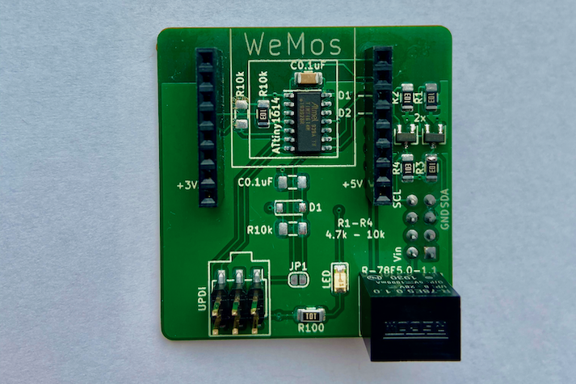
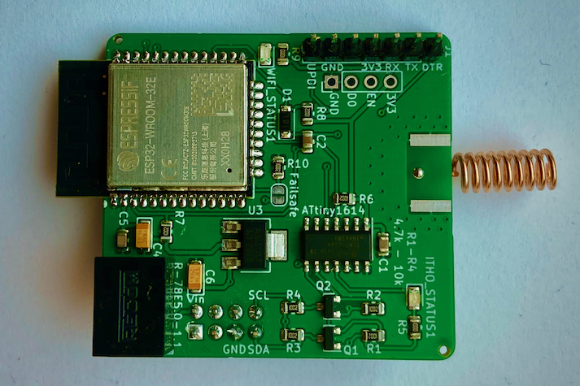
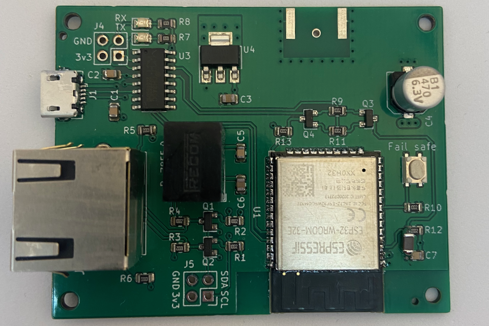

# Hardware revisions

Make sure to flash the correct firmware file! 
Flashing a firmware file for the wrong hardware revision will brick the device. This is reversible but especially with revision 2 you need extra hardware (USB-TTL adapter with a good power supply) to do so.

## CVE Add-on

Hardware revision 1:



Hardware revision 2:



## non-CVE wifi module

Hardware revision 1:



Since firmware version 2.6.0 hardware revision 2 and the non-cve module use the same firmware file.

## Flashing a blank ESP32 with esptool

The `nrgitho-vX.Y.Z.bin` files are application images for the update page of the web interface. A blank ESP32 (or a bricked add-on) also needs the bootloader, the partition table and the OTA data. These three files are in `unified_hw2_noncve/`: `bootloader.bin`, `partitions.bin` and `boot_app0.bin`. They do not change between firmware versions.

Linux / macOS (esptool 4.x; esptool 5.x spells the commands with dashes, like `write-flash`):

```
esptool.py --chip esp32 --port /dev/ttyUSB0 --baud 460800 erase_flash
esptool.py --chip esp32 --port /dev/ttyUSB0 --baud 460800 --before default_reset --after hard_reset write_flash -z \
  --flash_mode dio --flash_freq 40m --flash_size 4MB \
  0x1000 bootloader.bin 0x8000 partitions.bin 0xe000 boot_app0.bin 0x10000 nrgitho-vX.Y.Z.bin
```

Windows:

```
esptool --chip esp32 --port COM3 --baud 460800 erase_flash
esptool --chip esp32 --port COM3 --baud 460800 --before default_reset --after hard_reset write_flash -z --flash_mode dio --flash_freq 40m --flash_size 4MB 0x1000 bootloader.bin 0x8000 partitions.bin 0xe000 boot_app0.bin 0x10000 nrgitho-vX.Y.Z.bin
```

Erasing the flash also clears all settings, the add-on then starts its own access point for the first setup. If esptool cannot connect, hold the BOOT button while it tries, or lower the baud rate to 115200.